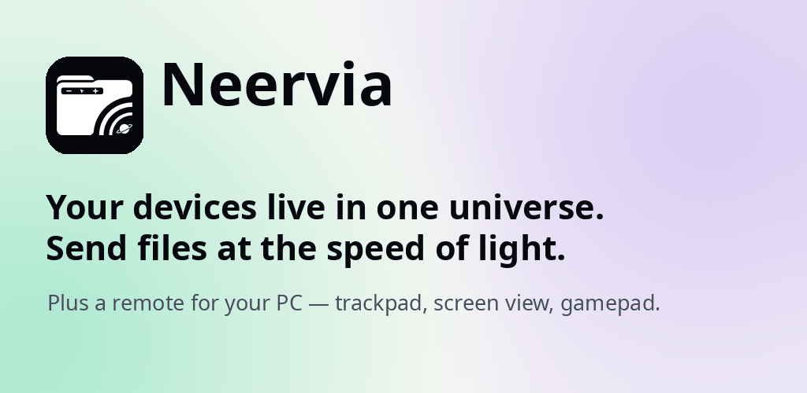
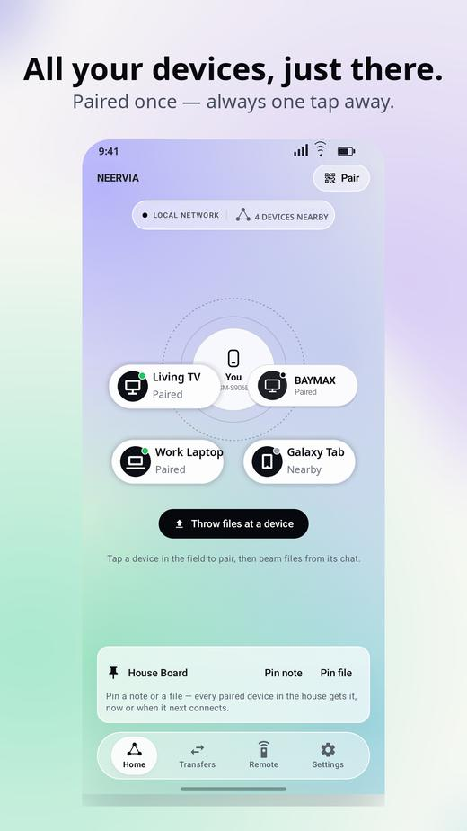
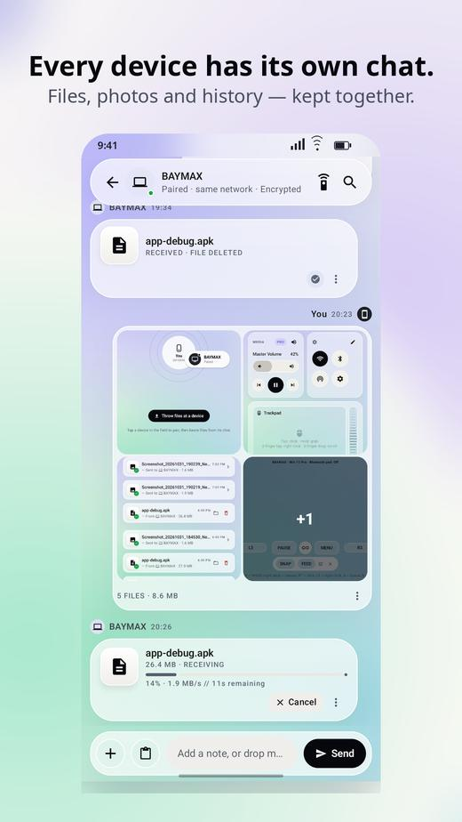
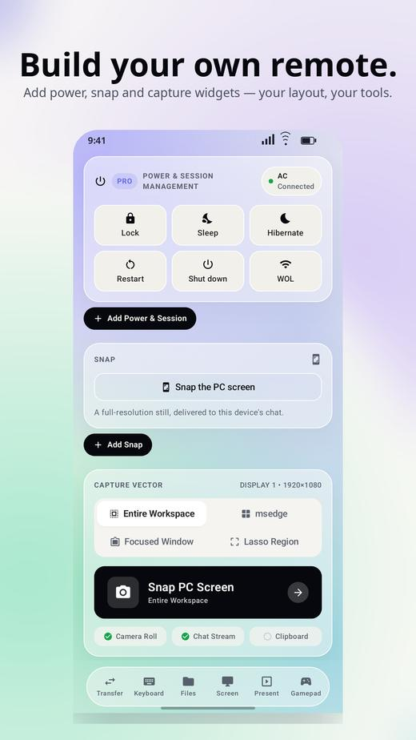
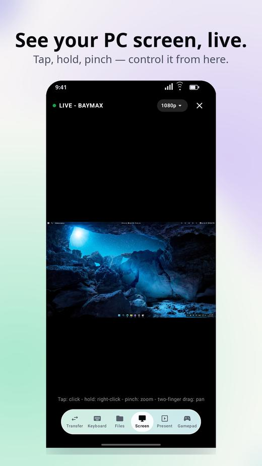
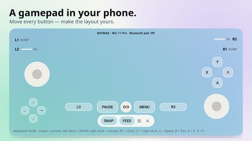

# Neervia – Nearby File Transfer

Send files between your own devices on the same network — phone to PC, PC to
phone, phone to phone, phone to TV. No internet, no cables, no cloud, no
accounts, no sign-up. Your devices find each other automatically, pair once
with a verification code, and every transfer is encrypted and goes directly
between them, never through a server. Neervia also turns your phone into a
remote for your Windows PC: trackpad, keyboard, live screen view,
presentations and a gamepad.

## Features

| | | |
|---|---|---|
|  |  |  |
| **Same-network discovery**: your devices appear in your orbit automatically | **Send anything**: files, folders, photos and videos up to 64 GB, with pause & resume | **PC remote control**: trackpad, keyboard and a widget canvas for your Windows PC |
|  |  |  |
| **Live screen view**: your PC screen on your phone, in real time | **Gamepad**: your phone becomes a controller for PC games | **Remote widgets**: media, volume, power, presentations, quick settings and more |

Transfers resume from where they stopped if a device sleeps, the network
drops or the app closes. On Android 13 and up, Wi-Fi Direct can even link two
Android devices with no network at all, and any device on the network can
drop files from a browser — nothing to install on that side.

Your files stay yours. Neervia has no servers and no accounts: transfers,
chats and history live only on your own devices. See the
[privacy policy](PRIVACY.md) (also at
[neervia.web.app/privacy](https://neervia.web.app/privacy)).

## Install

### Windows

Download `Neervia-Setup.exe` from
[Releases](https://github.com/mursman/get-neervia/releases) (or the
[latest release directly](https://github.com/mursman/get-neervia/releases/latest/download/Neervia-Setup.exe))
and run it. It installs per user — no admin rights needed.

**Quick start:** put your phone and PC on the same network, open Neervia on
both, and your devices appear in your orbit. Tap a device to send, or open
Remote to control the PC.

**"Neervia-Setup.exe isn't commonly downloaded"?** In your browser's
downloads, click **See more** (or **…**) next to the file, choose **Keep**,
then **Show more** → **Keep anyway**.

**"Windows protected your PC"?** The classic installer isn't code-signed
yet, so Windows SmartScreen shows a one-time caution for a new app. Click
**More info** → **Run anyway** and the installer runs as normal. The
Microsoft Store version is signed by Microsoft and shows no warning.

### Android

Download `Neervia.apk` from
[Releases](https://github.com/mursman/get-neervia/releases) (or the
[latest release directly](https://github.com/mursman/get-neervia/releases/latest/download/Neervia.apk))
and open it. Your phone may ask you to allow installs from your browser,
just for this install. Neervia is also on its way to Google Play and the
Microsoft Store — see the [website](https://neervia.web.app).

### Any browser

On the same network, a device without Neervia can still send and receive
through Browser Drop — open Neervia on one device and follow the Browser
Drop panel. Nothing to install.

## Support

Neervia is free. If it saves you time, there is an optional tip jar at
[neervia.web.app/support](https://neervia.web.app/support) — tips are
voluntary and unlock nothing.

## Bugs & feature requests

This repository is Neervia's public home for downloads and issue tracking:

- [Report a bug](https://github.com/mursman/get-neervia/issues/new?template=bug_report.yml)
- [Request a feature](https://github.com/mursman/get-neervia/issues/new?template=feature_request.yml)

Issues are public — please don't post private files, passwords, or anything
you wouldn't want the world to see.

## Changelog

See [CHANGELOG.md](CHANGELOG.md).

---

The Neervia apps are developed in a private repository; this one exists for
downloads, bug reports and feature requests. Website:
[neervia.web.app](https://neervia.web.app)
